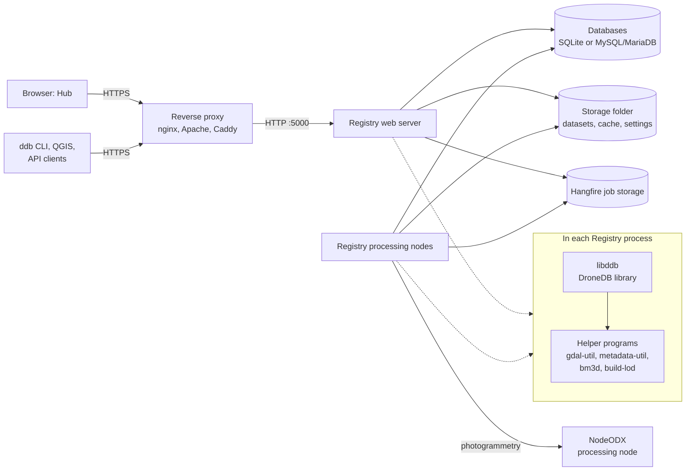

DroneDB **Registry** is the server behind DroneDB Hub. You can run your own Registry on your
own hardware. It stores the datasets, serves the Hub web app, the REST API, STAC and the OGC
services, and runs the builds that make the files viewable in the browser.

:::tip Do not want to run a server?

[DroneDB Hub](https://hub.dronedb.app) is the hosted Registry. Every plan has a 30-day free trial
([dronedb.app/plans](https://dronedb.app/plans)). Commercial support for self-hosted Registry is
available: [get in touch](https://dronedb.app/contact).

:::

## Architecture

| Part | What it does |
|------|--------------|
| **Registry** | ASP.NET Core application (`Registry.Web`) on .NET 10. It serves the REST API, STAC, OGC services and the Hub, and it runs background jobs. |
| **Hub** | The Vue web app. Registry embeds it and extracts it to `ClientApp/` in the storage folder when it starts. It is updated with Registry. |
| **libddb** | The DroneDB library (C++). Registry loads it in its own process. It indexes the files of each dataset and builds the files that the Hub shows (Cloud Optimized GeoTIFF, COPC point clouds, bm3d models, vector tiles, splat levels of detail). Registry 3.0 needs libddb **2.x**. |
| **Helper programs** | libddb starts programs of its package as child processes. `gdal-util` reads rasters, vectors and photos with GDAL, so a damaged file can stop only a worker of that program. `metadata-util` reads and writes image metadata (EXIF, XMP). `bm3d` builds 3D models. `build-lod` builds the levels of detail of Gaussian splats. Other programs (`untwine`, `Obj2Tiles`, `dwg2dxf`) are used when they are present. The Docker image and the DroneDB packages include them. |
| **Databases** | Three stores: identity (users and roles), registry (organizations, datasets, jobs) and Hangfire (the job queue). SQLite and an in-memory job queue by default; MySQL or MariaDB for production. |
| **Storage folder** | One folder (`/data` in the container) with `appsettings.json`, the datasets, the cache, the temporary files and the logs. |
| **Background jobs** | [Hangfire](https://www.hangfire.io/) runs the builds, imports, exports, clean-ups and e-mails. Builds have their own queue, so a long build does not block an import or a download. |
| **Processing nodes** | Extra Registry processes that run only background jobs. They share the databases and the storage folder with the web server. See [Processing nodes & features](/self-hosting/processing-nodes.mdx). |
| **NodeODX** | An OpenDroneMap processing node. Registry can send photos to it for photogrammetry. Optional. |

### Instance types

One Registry program has four roles. You choose the role with `--instance-type` (or the
`INSTANCE_TYPE` variable of the Docker image).

| Value | Role | Runs |
|-------|------|------|
| `0` | Default | Web server and background jobs in one process. The simplest setup. |
| `1` | Processing node | Background jobs only, no HTTP server. Needs a shared job store (MySQL/MariaDB). |
| `2` | Web server | HTTP only. Use it with one or more processing nodes. |
| `3` | Thumbnail generator | Thumbnails for a web server that sets `RemoteThumbnailGeneratorUrl`. |

## Choose a setup

| Setup | For | Page |
|-------|-----|------|
| One Docker container, SQLite | A test, a small team, one server | [Install → Docker](/self-hosting/install.mdx#docker) |
| Docker Compose: MariaDB, a web server and two processing nodes | Production | [Install → Docker Compose](/self-hosting/install.mdx#docker-compose-production) and the [Production checklist](/self-hosting/production.mdx) |
| Native binaries | A server without Docker, Windows | [Install → Native](/self-hosting/install.mdx#native) |

## Useful endpoints

| Endpoint | What it is |
|----------|------------|
| `/` | The Hub |
| `/scalar/v1` | Interactive API reference |
| `/version` | Version information |
| `/health/live` | Liveness probe, no sign-in |
| `/quickhealth`, `/health` | Health checks, for an administrator or with the `MonitorToken` |
| `/hangfire` | Background jobs dashboard, administrators only |
| `/stac` | STAC catalog root |

## Next steps

1. [Install](/self-hosting/install.mdx) Registry.
2. Go through the [Production checklist](/self-hosting/production.mdx).
3. Read the [Configuration reference](/self-hosting/configuration.mdx) for every setting.
4. [Add users and organizations](/self-hosting/users.mdx).
