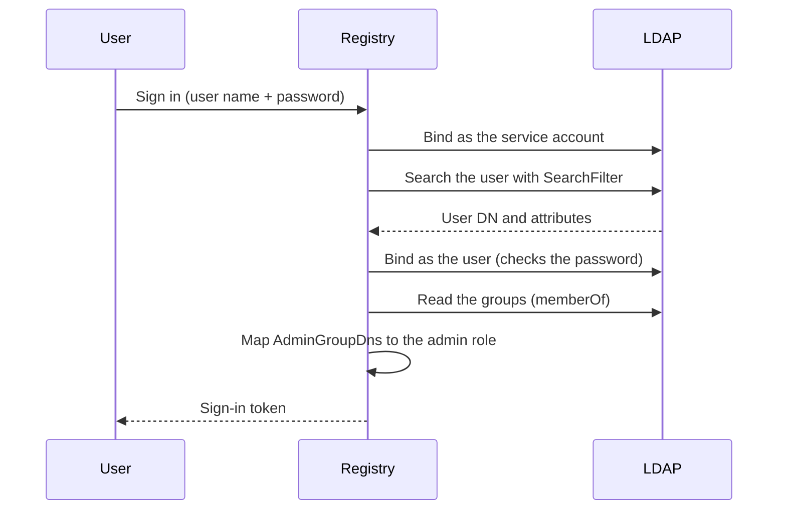

Registry can check passwords against an LDAP or Active Directory server instead of its own user
database. At each sign-in it reads the e-mail address, the display name and the groups of the user
from the directory. Members of the groups you name get the Registry `admin` role.

:::note

LDAP cannot be used together with external authentication (`ExternalAuthUrl`). Registry refuses
to start when both are set.

:::

## How a sign-in works



Registry has two ways to find the user:

1. **Search with a service account** (recommended). A service account (`BindDn`) searches the
   directory for the DN of the user, then Registry binds as the user to check the password. This
   also reads the attributes and the groups.
2. **Direct bind** (`UserDnFormat`). Registry builds the DN from the user name and binds without a
   search. Use it when the DN follows a fixed pattern (a UPN, or a fixed OU).

Registry escapes the user name (RFC 4515) before it puts it in a search filter, so a user name
cannot change the filter.

## Turn on LDAP

Add `LdapSettings` to the `AppSettings` section of `appsettings.json`. Every field is in the
[Configuration reference](./configuration.mdx#ldapsettings).

```json
"AppSettings": {
  "LdapSettings": {
    "Enabled": true,
    "Server": "ldap.example.com",
    "Port": 636,
    "UseSsl": true,
    "ValidateSslCertificate": true,
    "BaseDn": "dc=example,dc=com",
    "BindDn": "cn=serviceuser,ou=svcaccts,dc=example,dc=com",
    "SearchFilter": "(sAMAccountName={0})",
    "AdminGroupDns": [ "cn=registry-admins,ou=groups,dc=example,dc=com" ],
    "EmailAttribute": "mail",
    "DisplayNameAttribute": "displayName",
    "GroupMembershipAttribute": "memberOf",
    "Timeout": 30
  }
}
```

Set the password of the service account as an environment variable, not in the file:

```bash
AppSettings__LdapSettings__BindPassword=service-password
```

Every other field can be an environment variable too, for example
`AppSettings__LdapSettings__Server=ldap.example.com`.

When `Enabled` is `true`, Registry requires `Server`, `BaseDn` and a `SearchFilter` with `{0}`, and
refuses to start without them. Check the file with `Registry.Web <storage folder> --check`, then
restart Registry.

## Examples

### Active Directory

```json
"LdapSettings": {
  "Enabled": true,
  "Server": "dc.domain.com",
  "Port": 636,
  "UseSsl": true,
  "BaseDn": "dc=domain,dc=com",
  "BindDn": "CN=registry-svc,CN=Users,DC=domain,DC=com",
  "SearchFilter": "(sAMAccountName={0})",
  "AdminGroupDns": [ "CN=Registry-Admins,CN=Users,DC=domain,DC=com" ]
}
```

### OpenLDAP

```json
"LdapSettings": {
  "Enabled": true,
  "Server": "ldap.example.com",
  "Port": 636,
  "UseSsl": true,
  "BaseDn": "dc=example,dc=com",
  "BindDn": "cn=registry,ou=services,dc=example,dc=com",
  "SearchFilter": "(uid={0})",
  "AdminGroupDns": [ "cn=registry-admins,ou=groups,dc=example,dc=com" ],
  "DisplayNameAttribute": "cn"
}
```

### Direct bind with a UPN (Active Directory)

No service account is needed (`BindDn` can be `null`):

```json
"LdapSettings": {
  "Enabled": true,
  "Server": "dc.domain.com",
  "BaseDn": "dc=domain,dc=com",
  "UserDnFormat": "{0}@domain.com",
  "SearchFilter": "(sAMAccountName={0})",
  "AdminGroupDns": [ "CN=Registry-Admins,CN=Users,DC=domain,DC=com" ]
}
```

### Direct bind with a fixed OU (OpenLDAP)

```json
"LdapSettings": {
  "Enabled": true,
  "Server": "ldap.example.com",
  "BaseDn": "dc=example,dc=com",
  "UserDnFormat": "uid={0},ou=people,dc=example,dc=com",
  "SearchFilter": "(uid={0})",
  "AdminGroupDns": [ "cn=registry-admins,ou=groups,dc=example,dc=com" ],
  "DisplayNameAttribute": "cn"
}
```

With `UserDnFormat`, Registry still needs `SearchFilter`: after the bind it uses the filter to read
the attributes and the groups.

## What changes for users

| | With LDAP |
|-|-----------|
| User accounts | Come from the directory. The Hub hides **Manage Users**. |
| Passwords | Are changed in the directory, not in the Hub. |
| `admin` role | Comes from membership of a group in `AdminGroupDns`. |
| E-mail and display name | Are read from the directory at each sign-in. |

Local accounts, including the default `admin`, can no longer sign in. Before you turn LDAP on:

1. Back up the databases.
2. Make sure at least one directory user is in a group of `AdminGroupDns`.
3. Turn LDAP on, restart, and sign in with that user before you close the configuration.

## Health check

With LDAP on, the [health report](./production.mdx#health-checks-and-monitoring) (`/health`) has
an `LDAP health check` entry:

| State | Meaning |
|-------|---------|
| **Healthy** | The server answers and the bind (service account or anonymous) works. |
| **Degraded** | The server answers but refuses the anonymous bind. Set `BindDn` and `BindPassword` for a full check. |
| **Unhealthy** | The server cannot be reached (network error, timeout, connection refused). |

## Security

- Use LDAPS: `UseSsl: true` and `Port: 636`.
- Keep `ValidateSslCertificate: true`. Turn it off only to test with a self-signed certificate.
- Give the service account read access to the user attributes and groups only.
- Never commit `BindPassword` in a file.

## Troubleshooting

| Message or symptom | Fix |
|--------------------|-----|
| `AppSettings:LdapSettings:Server is required when LDAP is enabled` | Add `Server`. |
| `AppSettings:LdapSettings:BaseDn is required when LDAP is enabled` | Add `BaseDn`, for example `dc=example,dc=com`. |
| `AppSettings:LdapSettings:SearchFilter must contain the '{0}' placeholder for the username` | Put `{0}` in the filter, for example `(sAMAccountName={0})`. |
| `Cannot enable both LDAP (AppSettings:LdapSettings:Enabled) and external authentication (AppSettings:ExternalAuthUrl) simultaneously` | Remove `ExternalAuthUrl`, or turn LDAP off. |
| The health check is **Degraded** | The server refuses anonymous binds: set `BindDn` and `BindPassword`. |
| The e-mail or the display name is empty | Set `EmailAttribute` and `DisplayNameAttribute` to the attribute names of your directory. |
| A user does not get the `admin` role | `AdminGroupDns` must have the exact DN of the group, and the group must be in the `GroupMembershipAttribute` of the user. |
